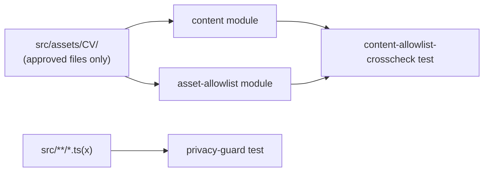

# Unit 2: Content Data & Asset Allowlist - Logical Components

No infrastructure components apply. All logical components are first-party modules and tests.

## `content` module (production)

- **Contains**: `PortfolioContent`, `getPortfolioContent()`, and the imported allowlisted assets it embeds.
- **Consumed by**: Units 4-5 content components (future).

## `asset-allowlist` module (production)

- **Contains**: `ALLOWED_ASSETS`, `isAllowedAsset()`, `getAllowlistedAssets()` (Pattern 2's flat literal).
- **Consumed by**: any component rendering an image (future units); the cross-check test (test-only consumer, Pattern 3).

## `privacy-guard` test (test-only)

- **Contains**: the Pattern 1 text-scan test.
- **Runs**: as part of `npm test`/CI, alongside every other Vitest suite.

## `content-allowlist-crosscheck` test (test-only)

- **Contains**: the Pattern 3 cross-check test.
- **Runs**: as part of `npm test`/CI.

## Integration Summary

