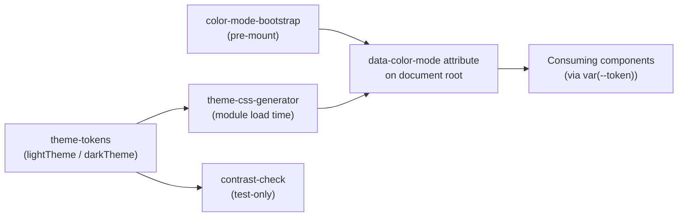

# Unit 1: Design Tokens & Theming - Logical Components

No infrastructure components (queues, caches, circuit breakers) apply to this unit. The logical components are all first-party, in-bundle (or test-only) modules:

## `theme-tokens` module (production)

- **Contains**: `lightTheme`, `darkTheme` (`Theme` instances), token type definitions.
- **Consumed by**: the CSS-generation step and, indirectly, every component via CSS custom properties.

## `theme-css-generator` module (production, module-load-time)

- **Contains**: The function implementing Pattern 2 — walks both themes once and produces the `[data-color-mode="..."]` CSS rule blocks.
- **Runs**: Once, at module load / build time; not invoked per-render.

## `color-mode-bootstrap` script (production, pre-mount)

- **Contains**: The synchronous pre-mount logic implementing Pattern 1 — calls `resolveColorModePreference()` and sets `data-color-mode` on the root element before the React tree mounts.
- **Runs**: Once per page load, before first paint.

## `contrast-check` utility (test-only)

- **Contains**: `contrastRatio(colorA, colorB): number`, implementing the WCAG relative-luminance formula for Pattern 4.
- **Consumed by**: `*.property.test.ts` files validating BR-3; excluded from the production bundle.

## Integration Summary

