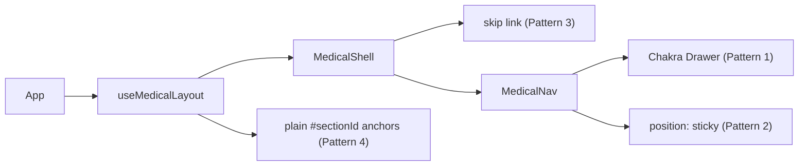

# Unit 3: Navigation & Layout Shell - Logical Components

No infrastructure components apply. All logical components are first-party React components, hooks, and tests.

## `MedicalShell` component (production)

- **Contains**: skip link (Pattern 3), `<header>` with `MedicalNav`, `<main id="main-content">`.

## `MedicalNav` component (production)

- **Contains**: sticky nav bar (Pattern 2), desktop links, mobile toggle + Chakra `Drawer` (Pattern 1), `ColorModeButton`.

## `useMedicalLayout` hook (production)

- **Contains**: the simplified single-mode navigation state from Functional Design (`activeSection`, `getNavigationHref`, `navigateToSection`), implementing Pattern 4's anchor format.

## Test components (test-only)

- Focus-trap/restoration interaction test (Pattern 1 verification).
- `aria-current`/skip-link-ordering example tests.
- Hash round-trip property test (`fast-check`).

## Integration Summary

