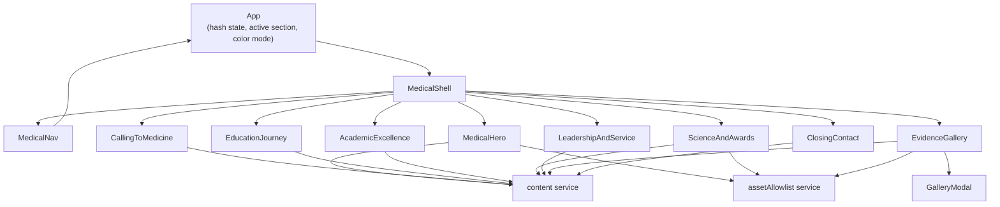

# Application Design - Component Dependencies

## Dependency Matrix

| Component | Depends On |
|---|---|
| `App` | `colorMode` service, `navigation` service, `MedicalShell` |
| `MedicalShell` | `MedicalNav`, all eight content-area components |
| `MedicalNav` | `navigation` service, `colorMode` service |
| `MedicalHero` | `content` service, `assetAllowlist` service (portrait) |
| `CallingToMedicine` | `content` service |
| `EducationJourney` | `content` service, `TimelineEntry` |
| `AcademicExcellence` | `content` service, `ScoreCard` |
| `ScienceAndAwards` | `content` service, `assetAllowlist` service (certificates), `AwardItem` |
| `LeadershipAndService` | `content` service |
| `EvidenceGallery` | `content` service, `assetAllowlist` service, `GalleryItem`, `GalleryModal` |
| `ClosingContact` | `content` service |
| `ScoreCard` / `AwardItem` / `TimelineEntry` / `GalleryItem` | None (pure presentational; receive data via props) |
| `GalleryModal` | None (receives item data and callbacks via props) |

## Communication Patterns

- **Top-down data flow only**: `App` derives active-section and color-mode state and passes it down through props; content-area components never write back to `App` directly except via well-defined callbacks (e.g., `EvidenceGallery.openItem`/`closeModal`, `MedicalNav.toggleMobileMenu`).
- **No cross-section coupling**: Content-area components do not depend on each other; each reads independently from the `content` service.
- **Single privacy-boundary chokepoint**: Every component that renders an image path (`MedicalHero`, `ScienceAndAwards`/`AwardItem`, `EvidenceGallery`/`GalleryItem`) must resolve that path through `assetAllowlist.isAllowedAsset` before rendering — no component bypasses this check.
- **Modal focus handoff**: `EvidenceGallery` passes the triggering `GalleryItem`'s element reference to `GalleryModal` so focus can be restored on close; this is the only parent-child ref-passing relationship in the design.

## Data Flow Diagram

