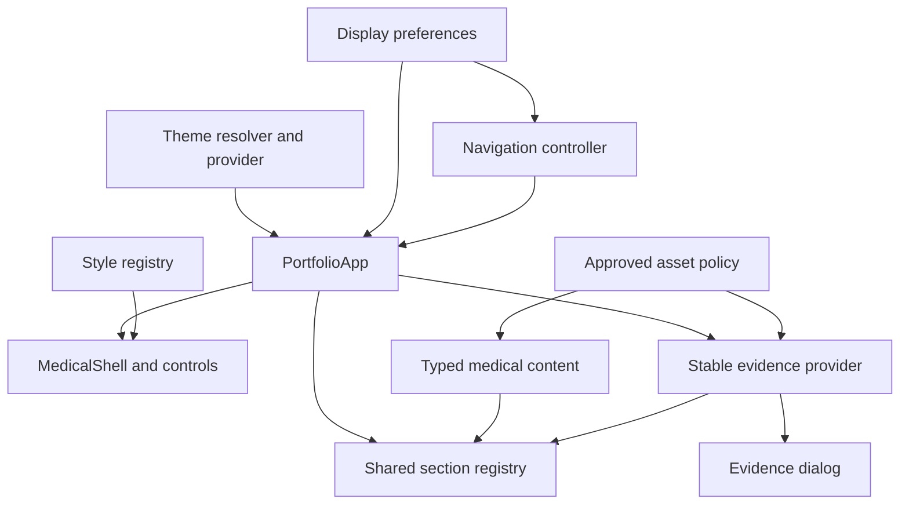

# Component Dependencies — Stratus Visual Refresh

## Dependency matrix

| Consumer | Direct dependencies | Communication / ownership |
| --- | --- | --- |
| PortfolioApp | preferences, navigation, content, gallery, style metadata | Single composition owner; state/actions passed downward |
| Navigation controller | validated preferences, route helpers, enabled IDs, scroll/focus helpers | Browser events in; validated state/actions out |
| MedicalShell / MedicalNav | style metadata, navigation/display props, theme provider | User commands upward; selected state downward |
| Display controls | style/layout selection callbacks, theme context | Native named/selected control semantics; no direct competing route state |
| Section renderer / links | typed content, effective view, common navigation | Stable keyed components; real layout-aware hrefs |
| Content sections | current content types, section primitives, evidence context where applicable | No presentation-specific content copy |
| Evidence provider | gallery validation utilities, allowlist, lifecycle/focus coordinator | Stable state; evidence open/failure methods; view reconciliation |
| Gallery dialog/cards / award previews | shared evidence provider, approved metadata | Same selected item and keyboard/focus behavior in both styles |
| Contact / CV actions | current contact/CV typed data and asset checks | Native mailto/download actions; retain existing validation |
| Theme bootstrap/provider | shared normalized color policy, generated tokens | Same initial color; provider owns later changes |
| Build verifier / tests | assembled public module graph and output | Production policy enforced independently of presentation |

## Data-flow diagram

Text alternative: theme and preferences feed PortfolioApp/navigation. PortfolioApp composes the shell, shared sections and one stable evidence provider. Style metadata configures the shell; shared medical data configures sections. Evidence supplies section preview controls and the dialog. The approved asset policy validates both data and evidence.

Arrows show data/composition dependencies, not React nesting: the evidence provider wraps shell/content so it survives view changes. User commands travel upward via callbacks to the app/navigation owner; rendered selection travels down. No component imports a second copy of the medical data for a style. Focus coordination belongs at the composition boundary to avoid cycles between content and nav.

## Integration invariants

1. Exactly one effective layout owner and one shared color owner; direct route precedence is explicit.
2. Section IDs/heading semantics are stable; full-page and section modes use the same renderer entries.
3. Style changes do not key-remount provider/App or duplicate source facts.
4. Section controls generate active-layout hrefs; evidence actions remain previews, CV remains the actual PDF.
5. Dialog/drawer closing and committed-navigation focus cannot race; absent headings are never the only fallback.
6. The allowlist/public build verifier remain authoritative; styling does not widen the asset graph.
7. Root/project base paths require only the existing bundler asset mechanism; hashes remain client-side.
## Extension compliance

Security Baseline: N/A, disabled B. Property-Based Testing: N/A, disabled C. Full rules not loaded; enforcement skipped according to Extension Configuration. Existing privacy/allowlist checks and property suites remain required. No enabled-extension blocking findings.
