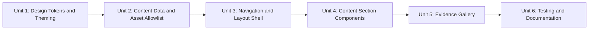

# Medical Student Portfolio Revamp - Unit of Work Dependencies

Strictly sequential execution approved (Question 3, Option A): each unit is fully completed, including its own code and colocated tests, before the next unit begins.

## Dependency Matrix

| Unit | Depends On | Reason |
|---|---|---|
| 1. Design Tokens & Theming | None | Foundation; no other unit's code is needed to define tokens. |
| 2. Content Data & Asset Allowlist | Unit 1 (sequenced, not structurally required) | No data dependency on tokens, but executed second per approved strict ordering. |
| 3. Navigation & Layout Shell | Unit 1, Unit 2 | Shell applies design tokens and its color-mode control/content reads through `content`/`assetAllowlist`. |
| 4. Content Section Components | Unit 1, Unit 2, Unit 3 | Components render inside `MedicalShell` and consume `content`/`assetAllowlist`. |
| 5. Evidence Gallery | Unit 1, Unit 2, Unit 3 | Gallery renders inside `MedicalShell` and consumes `content`/`assetAllowlist`; independent of Unit 4's non-gallery components. |
| 6. Testing & Documentation | Unit 1, Unit 2, Unit 3, Unit 4, Unit 5 | Validates and documents the fully assembled system. |

## Sequence Diagram

## Notes on Parallelization

- Units 4 and 5 have no dependency on each other (both only depend on Units 1-3), but the approved strict-sequential ordering (Question 3, Option A) still completes Unit 4 fully before starting Unit 5, matching the Construction phase's per-unit loop, which processes one unit at a time.
- No unit depends on Unit 6; Unit 6 exists solely to validate and document the output of Units 1-5.
