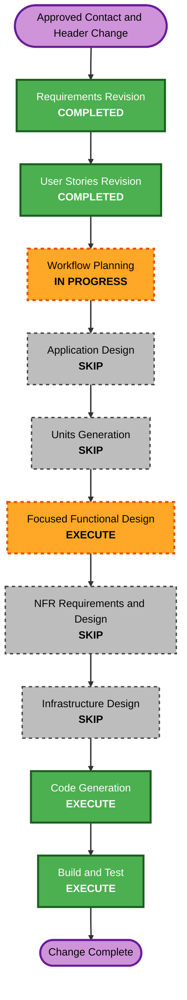
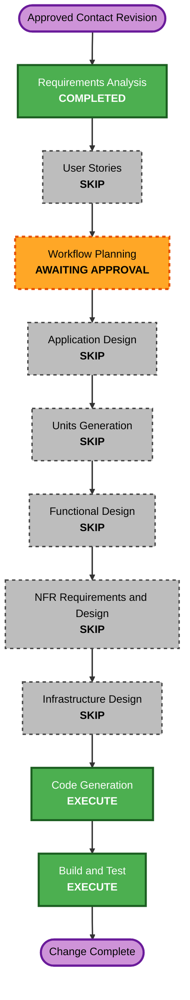
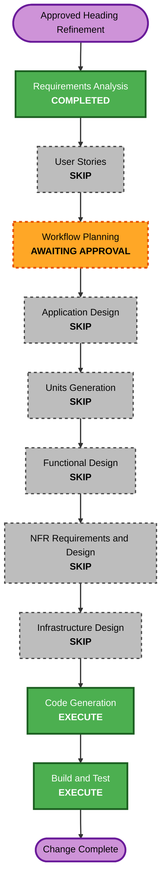

# Execution Plan

## Detailed Analysis Summary

### Transformation Scope (Brownfield)

- **Transformation Type**: Single-application, system-wide presentation transformation. No architectural, infrastructure, or deployment-model change.
- **Primary Changes**: Replace the Engineering/Business template pair and their data models with one unified medical portfolio (design tokens, content data, components, navigation, gallery, tests, docs).
- **Related Components**: Template registry and style-selector components, shared layout/navigation shell, color-mode persistence, existing content data modules, existing example-based test suite, repository documentation. No CDK/infrastructure packages exist; this is a purely static Vite/React frontend deployed to GitHub Pages.

### Change Impact Assessment

- **User-facing changes**: Yes - full visual identity, content, and navigation redesign.
- **Structural changes**: Yes, within the application layer only - template consolidation, new data models, new/rebuilt components (hero, timeline, score cards, awards, gallery with modal). No service, database, or infrastructure architecture change.
- **Data model changes**: Yes - new typed content and evidence-asset-allowlist data modules replacing engineering/business data models.
- **API changes**: None - no backend or API exists or is introduced.
- **NFR impact**: Yes - accessibility (WCAG 2.2 AA), responsive design, performance (lazy loading, layout shift), maintainability, reliability/compatibility, and both example-based and property-based testing are all explicitly required (NFR-01 through NFR-08).

### Component Relationships (Brownfield)

```markdown
## Component Relationships
- **Primary Component**: Portfolio frontend application (single Vite/React app at workspace root)
- **Infrastructure Components**: None (static GitHub Pages hosting only; no CDK/Terraform)
- **Shared Components**: App shell/hash routing, layout state, color-mode persistence, GitHub Pages base-path handling (retained)
- **Dependent Components**: None external; this is a standalone static site
- **Supporting Components**: Existing GitHub Actions deployment workflow, existing Vitest/ESLint/TypeScript tooling, new `fast-check` property-based testing dependency
```

For each related component:
- **Template registry & style selector** - Change Type: Major (removal/replacement) - Reason: Direct dependency of FR-01/FR-14 - Priority: Critical
- **Content data models** - Change Type: Major (replacement) - Reason: FR-13 - Priority: Critical
- **Layout/navigation shell** - Change Type: Minor (simplify, remove layout toggle) - Reason: FR-03/FR-14 - Priority: Important
- **Color-mode persistence** - Change Type: Minor (retarget tokens, keep mechanism) - Reason: FR-12 - Priority: Important
- **Test suite & documentation** - Change Type: Major (rewrite) - Reason: NFR-06/NFR-07/FR-16 - Priority: Important
- **GitHub Actions/Pages deployment** - Change Type: Configuration-only (no change expected) - Reason: NFR-08 - Priority: Optional

### Risk Assessment

- **Risk Level**: Medium. The change is system-wide in scope but confined to a single static frontend application with no infrastructure, backend, or external integration risk. The primary risk is content/privacy correctness (evidence sourcing, asset allowlist) rather than technical complexity.
- **Rollback Complexity**: Easy - static site, version-controlled, no data migration or irreversible external state.
- **Testing Complexity**: Moderate - accessibility, responsive, color-mode, asset-boundary, and new property-based tests all need coverage, but no integration with external systems.

## Workflow Visualization

```mermaid
flowchart TD
    Start(["User Request: Medical Student Portfolio Revamp"])

    subgraph INCEPTION["🔵 INCEPTION PHASE"]
        WD["Workspace Detection<br/><b>COMPLETED</b>"]
        RE["Reverse Engineering<br/><b>COMPLETED</b>"]
        RA["Requirements Analysis<br/><b>COMPLETED</b>"]
        US["User Stories<br/><b>COMPLETED</b>"]
        WP["Workflow Planning<br/><b>IN PROGRESS</b>"]
        AD["Application Design<br/><b>EXECUTE</b>"]
        UP["Units Generation<br/><b>EXECUTE</b>"]
    end

    subgraph CONSTRUCTION["🟢 CONSTRUCTION PHASE"]
        FD["Functional Design (per unit)<br/><b>EXECUTE</b>"]
        NFRA["NFR Requirements (per unit)<br/><b>EXECUTE</b>"]
        NFRD["NFR Design (per unit)<br/><b>EXECUTE</b>"]
        ID["Infrastructure Design (per unit)<br/><b>SKIP</b>"]
        CG["Code Generation (per unit)<br/><b>EXECUTE</b>"]
        BT["Build and Test<br/><b>EXECUTE</b>"]
    end

    subgraph OPERATIONS["🟡 OPERATIONS PHASE"]
        OPS["Operations<br/><b>PLACEHOLDER</b>"]
    end

    Start --> WD --> RE --> RA --> US --> WP --> AD --> UP
    UP --> FD --> NFRA --> NFRD --> ID --> CG --> BT --> End(["Complete"])
    BT -.-> OPS

    style WD fill:#4CAF50,stroke:#1B5E20,stroke-width:3px,color:#fff
    style RE fill:#4CAF50,stroke:#1B5E20,stroke-width:3px,color:#fff
    style RA fill:#4CAF50,stroke:#1B5E20,stroke-width:3px,color:#fff
    style US fill:#4CAF50,stroke:#1B5E20,stroke-width:3px,color:#fff
    style WP fill:#FFA726,stroke:#E65100,stroke-width:3px,stroke-dasharray: 5 5,color:#000
    style AD fill:#FFA726,stroke:#E65100,stroke-width:3px,stroke-dasharray: 5 5,color:#000
    style UP fill:#FFA726,stroke:#E65100,stroke-width:3px,stroke-dasharray: 5 5,color:#000
    style FD fill:#FFA726,stroke:#E65100,stroke-width:3px,stroke-dasharray: 5 5,color:#000
    style NFRA fill:#FFA726,stroke:#E65100,stroke-width:3px,stroke-dasharray: 5 5,color:#000
    style NFRD fill:#FFA726,stroke:#E65100,stroke-width:3px,stroke-dasharray: 5 5,color:#000
    style ID fill:#BDBDBD,stroke:#424242,stroke-width:2px,stroke-dasharray: 5 5,color:#000
    style CG fill:#4CAF50,stroke:#1B5E20,stroke-width:3px,color:#fff
    style BT fill:#4CAF50,stroke:#1B5E20,stroke-width:3px,color:#fff
    style OPS fill:#FFF59D,stroke:#F57F17,stroke-width:2px,stroke-dasharray: 5 5,color:#000
    style Start fill:#CE93D8,stroke:#6A1B9A,stroke-width:3px,color:#000
    style End fill:#CE93D8,stroke:#6A1B9A,stroke-width:3px,color:#000

    linkStyle default stroke:#333,stroke-width:2px
```



## Phases to Execute

### 🔵 INCEPTION PHASE

- [x] Workspace Detection (COMPLETED)
- [x] Reverse Engineering (COMPLETED)
- [x] Requirements Analysis (COMPLETED)
- [x] User Stories (COMPLETED)
- [x] Workflow Planning (IN PROGRESS - this document)
- [ ] Application Design - **EXECUTE**
  - **Rationale**: The unified medical experience needs new/rebuilt components (hero, education timeline, score cards, awards grid, leadership/service list, evidence gallery with modal, unified nav) and a redesigned service/data layer (typed content modules, asset allowlist). Component responsibilities and boundaries are not yet defined and are non-trivial given FR-01 through FR-15.
- [ ] Units Generation - **EXECUTE**
  - **Rationale**: The change spans multiple distinct concerns (design tokens/theming, content data + allowlist, navigation/layout shell, content-section components, evidence gallery, testing/documentation) that benefit from being decomposed into focused units with clear dependency ordering, rather than one undifferentiated implementation pass.

### 🟢 CONSTRUCTION PHASE

- [ ] Functional Design (per unit) - **EXECUTE**
  - **Rationale**: New data models (content schema, evidence-asset allowlist) and business rules (allowlist enforcement, hash-anchor navigation, color-mode persistence/validation) require explicit design before coding, per FR-13, FR-15, FR-03, FR-12.
- [ ] NFR Requirements (per unit) - **EXECUTE**
  - **Rationale**: NFR-01 (accessibility), NFR-02 (responsive), NFR-03 (performance), NFR-05 (reliability/compatibility), NFR-06 (example testing), and NFR-07 (property-based testing with `fast-check`) all apply and need per-unit tech/pattern decisions (e.g., which components need generators, which need reduced-motion handling).
- [ ] NFR Design (per unit) - **EXECUTE**
  - **Rationale**: Follows directly from NFR Requirements; concrete patterns (token structure, lazy-loading strategy, focus-management pattern for the gallery modal, property-based test generator design) need to be designed before Code Generation.
- [ ] Infrastructure Design (per unit) - **SKIP**
  - **Rationale**: No infrastructure, backend, hosting, or deployment-architecture change is in scope (NFR-08 explicitly preserves the existing static GitHub Pages workflow with no backend, database, or new service).
- [ ] Code Generation (per unit) - **EXECUTE (ALWAYS)**
  - **Rationale**: Implementation planning and code generation are required to deliver the revamp.
- [ ] Build and Test - **EXECUTE (ALWAYS)**
  - **Rationale**: Build, lint, type-check, example-based test, property-based test, and production-build verification are required per NFR-05, NFR-06, NFR-07, and Acceptance Criteria 14-17.

### 🟡 OPERATIONS PHASE

- [ ] Operations - **PLACEHOLDER**
  - **Rationale**: Placeholder stage; deployment/monitoring workflow expansion is out of scope for this change (Out of Scope: "Deploying the site or changing repository hosting settings during this workflow").

## Package Change Sequence (Brownfield Only)

Single application, no separate packages/services. Recommended intra-application unit sequence (dependency-ordered, to be finalized in Units Generation):

1. **Design Tokens & Theming** - foundation for every visual component (FR-02, FR-12).
2. **Content Data & Asset Allowlist** - typed data modules and the privacy-safe evidence allowlist that all content components consume (FR-13, FR-15).
3. **Navigation & Layout Shell** - unified single-page shell, sticky/mobile nav, skip link, color-mode control (FR-01, FR-03, FR-12, FR-14).
4. **Content Section Components** - hero, calling-to-medicine narrative, education timeline, academic score cards, science/awards, leadership/service (FR-04 through FR-09).
5. **Evidence Gallery** - accessible gallery and modal, depends on the finalized asset allowlist (FR-10).
6. **Testing & Documentation** - regression/property-based tests and repository documentation, finalized once components stabilize (NFR-06, NFR-07, FR-16).

## Estimated Timeline

- **Total Phases**: 2 remaining Inception stages (Application Design, Units Generation) + up to 4 Construction stages per unit (Functional Design, NFR Requirements, NFR Design, Code Generation) across ~6 units, then one Build and Test pass.
- **Estimated Duration**: Single focused work session per unit; overall a few work sessions given the content volume and privacy-review care required, not a multi-week effort.

## Success Criteria

- **Primary Goal**: A single, privacy-safe, accessible medical portfolio for Bui Tuan Phat that fully replaces the prior engineering/business identity while preserving static GitHub Pages delivery.
- **Key Deliverables**: Unified theme/tokens, typed content + allowlist data modules, redesigned navigation/layout shell, all eight content sections, accessible evidence gallery, updated example-based and property-based tests, updated documentation.
- **Quality Gates**: TypeScript strict compilation, ESLint, Vitest (example-based and property-based) all passing; production build succeeds; no prohibited asset present in the build output; WCAG 2.2 AA contrast targets met; all 18 acceptance criteria in `requirements.md` satisfied.
- **Integration Testing**: Not applicable in the service-integration sense (no external services); equivalent verification is end-to-end rendering/navigation/asset-boundary tests across the unified single-page app.
- **Operational Readiness**: Not applicable this cycle (Operations phase remains a placeholder; no deployment change is in scope).

## Contact and Shared Section Hierarchy Change-Control Addendum

This addendum is the authoritative execution plan for the approved 2026-09-20 Contact and section-header change. It preserves the previously approved medical portfolio architecture and narrows execution to the existing affected units.

### Detailed Analysis Summary

- **Transformation type**: Focused, cross-component presentation and typed-content change inside one static React application.
- **User-facing impact**: Add two clearly labeled, non-interactive fictional Contact cards and rebalance every shared content section so the main content receives approximately 72% of desktop width.
- **Structural impact**: Extend the existing medical content contract and `ClosingContact` props; retain `MedicalSection`, `ClosingContact`, and the current application composition.
- **Data-model impact**: Small typed extension for Contact labels, values, placeholder status, and closing copy.
- **API, dependency, and infrastructure impact**: None.
- **NFR impact**: Responsive hierarchy and semantic accessibility are affected, but the approved CSS, React, Vitest, Testing Library, and fast-check patterns remain sufficient.
- **Risk level**: Medium because the change touches shared section styling and privacy regression rules across production source, tests, and documentation.
- **Rollback complexity**: Easy; all changes are local, static, and version-controlled.
- **Testing complexity**: Moderate; desktop and mobile layout contracts, non-interactive semantics, exact placeholder distinction, prior-owner exclusion, and production-build policy all require regression coverage.

### Component Relationships

- **Primary components**: `PortfolioContent`, `content`, `ClosingContact`, and `medical-content.css`.
- **Shared dependency**: `MedicalSection` supplies the repeated header/body structure whose CSS changes affect all seven non-hero sections.
- **Composition point**: `PortfolioApp` passes typed Contact data into `ClosingContact`.
- **Supporting components**: Content, privacy, component, full-app, production-graph, documentation-contract, and production-output tests.
- **Deployment dependency**: Existing Vite and GitHub Pages flow; no change required.

### Workflow Visualization



Text alternative: the approved requirements and stories flow into Workflow Planning. Application Design and Units Generation are skipped, followed by focused Functional Design for the existing data and content-component units. NFR Requirements, NFR Design, and Infrastructure Design are skipped. Code Generation then updates the three affected units before the final Build and Test gate.

### Phase Decisions

#### Inception

- [x] Requirements Analysis revision - **COMPLETED**.
- [x] User Stories revision - **COMPLETED**.
- [x] Workflow Planning analysis and plan generation - **COMPLETED; AWAITING APPROVAL**.
- [x] Application Design - **SKIP** because the change stays within the approved `PortfolioContent`, `MedicalSection`, and `ClosingContact` boundaries and introduces no new service or component dependency.
- [x] Units Generation - **SKIP** because the existing Unit 2, Unit 4, and Unit 6 decomposition remains valid and Story 17 is already mapped to Unit 4.

#### Construction

- [ ] Focused Functional Design - **EXECUTE** for Unit 2 and Unit 4 because the typed Contact contract and its presentation rules need an explicit design update.
- [x] NFR Requirements - **SKIP** because the approved accessibility, responsive, privacy, maintainability, and testing requirements already state the complete constraints.
- [x] NFR Design - **SKIP** because existing semantic HTML, CSS-grid, responsive-breakpoint, privacy-guard, and test patterns are sufficient; no new pattern or technology choice is needed.
- [x] Infrastructure Design - **SKIP** because hosting, CI, assets, and deployment architecture do not change.
- [ ] Code Generation - **EXECUTE** for affected Units 2, 4, and 6 using an explicitly approved code-generation plan.
- [ ] Build and Test - **EXECUTE** with type-check, lint, example tests, property tests, deterministic seed replay, production builds, privacy scans, bundle verification, and diff validation.

### Existing-Unit Change Sequence

1. **Unit 2: Content Data and Asset Allowlist** - Extend the typed content contract and data while preserving the separate prohibition on CV placeholder values.
2. **Unit 4: Content Section Components** - Render semantic Contact cards and update the shared 28/72 desktop layout plus reduced mobile heading scale.
3. **Unit 6: Testing and Documentation** - Update cross-cutting policy fixtures, regression coverage, production-graph expectations, and README guidance.
4. **Build and Test** - Validate the integrated static application and exact production output.

The update approach is sequential because Unit 4 consumes the Unit 2 contract and Unit 6 validates the integrated result. No parallel package coordination or versioning is required.

### Success Criteria

- Contact displays `student.email@example.com` and `+84 XXX XXX XXX` as visibly labeled placeholders with no links, form controls, or submission behavior.
- The CV-only values `testemail@gmail.com` and `123456789` and all former-owner contact details remain prohibited from website output.
- Shared desktop content sections use an approximately 28/72 header-to-content split and cap their main headings near 4rem.
- Single-column and narrow mobile layouts reduce heading scale enough to keep main content prominent without horizontal overflow.
- The data remains typed and editable outside presentation components.
- Tests and documentation distinguish approved website placeholders from prohibited CV placeholders.
- The full quality and production verification gates pass without dependency, infrastructure, or asset-inventory changes.

### Extension Compliance

- **Security Baseline**: Skipped because it remains explicitly disabled in `aidlc-state.md`.
- **Property-Based Testing**: Compliant at planning level; Functional Design identified generated Contact non-interactivity and section-structure invariants for PBT. Fixed responsive ratios, caps, and breakpoints use concrete CSS-source/browser checks because they are declarative constants rather than transformations over randomized domain input. Deterministic replay of the full suite remains required.
- **Blocking findings**: None.

## Contact Email Draft Revision Addendum

This addendum is the authoritative workflow plan for the approved email-only Contact revision.

### Detailed Analysis Summary

- **Transformation type**: Focused interaction change within the existing Contact section.
- **Primary changes**: Replace placeholder cards with a controlled email-draft form, revise the typed Contact data contract, reuse the existing `buildMailtoUrl` utility, and update focused regressions and documentation.
- **User-facing impact**: Yes; visitors can enter their name, reply-to email, and a message and open a draft addressed to `buituanphat123456@gmail.com`.
- **Structural impact**: Minor; the existing `ClosingContact` boundary is retained while its props and internal form behavior change.
- **Data-model impact**: Minor; placeholder channels become verified recipient and form-copy configuration.
- **API, dependency, infrastructure, and deployment impact**: None.
- **NFR impact**: Accessible validation, responsive form layout, privacy disclosure, and a 5,000-character limit are added within existing standards.
- **Risk level**: Low to moderate because the change is isolated and locally reversible, but browser handoff through `mailto:` requires precise encoding and honest delivery language.
- **Testing complexity**: Moderate; tests must cover rendering, validation, character limits, URL composition, privacy wording, retired-placeholder absence, and existing application gates.

### Component Relationships

- **Primary component**: `src/components/medical/content/ClosingContact.tsx` owns the form state, validation feedback, and draft-opening action.
- **Typed content contract**: `src/types/medicalPortfolio.ts` defines the revised Contact configuration.
- **Content data**: `src/data/medical/content.ts` supplies the verified recipient and visitor-facing explanatory copy.
- **Draft utility**: `src/utils/contact.ts` performs deterministic percent-encoded `mailto:` composition.
- **Presentation**: `src/components/medical/content/medical-content.css` owns the reference-informed responsive form surface.
- **Supporting validation**: Contact component tests, utility tests, application regressions, privacy and production checks, TypeScript, ESLint, Vitest, and both Vite base-path builds.

### Workflow Visualization



Text alternative: approved Contact requirements proceed through the mandatory Workflow Planning gate. User Stories and all conditional design stages are skipped. Code Generation updates the existing Contact component, typed content, utility, styles, tests, and documentation, followed by Build and Test.

### Phase Decisions

#### Inception

- [x] Workspace Detection - **COMPLETED**; the existing brownfield React/Vite application and AI-DLC state remain authoritative.
- [x] Reverse Engineering - **SKIP**; current reverse-engineering artifacts plus focused source inspection are sufficient.
- [x] Requirements Analysis - **COMPLETED AND APPROVED** on 2026-09-26.
- [x] User Stories - **SKIP BY USER DIRECTION**; the focused workflow and acceptance criteria are fully specified, and the user requested direct progression to Code Generation where possible.
- [x] Workflow Planning - **COMPLETED; AWAITING APPROVAL**.
- [x] Application Design - **SKIP**; the existing component, data, utility, and styling boundaries remain valid.
- [x] Units Generation - **SKIP**; the existing Content Section Components and Testing/Documentation units cover the change.

#### Construction

- [x] Functional Design - **SKIP**; requirements define the fields, validation, counter, draft contract, and failure behavior without a complex domain model.
- [x] NFR Requirements - **SKIP**; accessibility, privacy, responsive, compatibility, and static-hosting constraints are explicit.
- [x] NFR Design - **SKIP**; existing React controlled-input, semantic form, CSS breakpoint, and pure-utility patterns are sufficient.
- [x] Infrastructure Design - **SKIP**; no backend, dependency, workflow, hosting, or environment change is allowed.
- [ ] Code Generation - **EXECUTE** with a concise implementation plan and approval gate.
- [ ] Build and Test - **EXECUTE** with focused and full validation.

### Update Sequence

1. Revise the Contact types and content data to expose the verified email-only configuration.
2. Strengthen the existing mailto composer and add focused unit tests for trimming and percent encoding.
3. Replace placeholder cards in `ClosingContact` with the accessible controlled form and local email-draft handoff.
4. Add the responsive reference-informed Contact styles while preserving the shared compact section hierarchy.
5. Replace outdated placeholder assertions with form, validation, privacy, and recipient regressions.
6. Update relevant repository documentation and run the complete quality gates.

### Success Criteria

- The Contact section is email-only and addresses drafts to `buituanphat123456@gmail.com`.
- Name, Reply-to email, and Message have persistent labels, required validation, visible focus, and associated accessible errors.
- Message input is limited to 5,000 characters with a live counter.
- Valid input creates the expected percent-encoded local email draft without network submission, storage, or a false sent state.
- The placeholder phone, fictional placeholder email, and former-owner address are absent from the website UI and production source graph.
- The Contact surface matches the supplied reference's hierarchy while retaining the portfolio's medical palette, compact heading rail, responsive behavior, and light/dark modes.
- Focused tests, full tests, deterministic property replay, TypeScript, ESLint, production policy checks, and both Vite base-path builds pass.

### Extension Compliance

- **Security Baseline**: Skipped because it remains explicitly disabled in `aidlc-state.md`; independent privacy constraints remain mandatory.
- **Property-Based Testing**: Skipped because it remains explicitly disabled for extension enforcement; existing property suites and deterministic replay remain mandatory.
- **Blocking findings**: None.

## Visual Showcase and Evidence Enhancement Addendum

This addendum is the authoritative execution plan for the approved 2026-09-25 visual showcase, award evidence, GPA, and dialog-spacing change. It preserves the current single medical portfolio architecture and follows the user's request to skip directly toward Code Generation wherever AI-DLC permits.

### Detailed Analysis Summary

- **Transformation type**: Multi-component presentation and interaction enhancement within one static React application.
- **Primary changes**: Compact the shared header rail, redesign award cards around larger evidence, connect award evidence to the existing dialog, prevent GPA scale wrapping, add responsive dialog top inset, and apply cohesive site-wide visual polish.
- **User-facing impact**: High visual impact across every section, plus a new award-to-dialog entry path.
- **Structural impact**: Minor; existing medical section, award, gallery dialog, theme, and navigation boundaries remain authoritative.
- **Data-model/API impact**: None expected; current award evidence and gallery metadata contain the required fields.
- **Dependency/infrastructure impact**: None.
- **NFR impact**: Responsive layout, keyboard access, focus restoration, dialog reachability, light/dark parity, reduced motion, and performance must remain intact.
- **Risk level**: Medium because shared CSS affects every section and the dialog gains a second trigger source.
- **Rollback complexity**: Easy; changes remain local and version-controlled with no migration or external state.
- **Testing complexity**: Moderate; focused DOM, CSS-source, interaction, focus, privacy, and production-output regressions are required.

### Component Relationships

- **Shared layout**: `MedicalSection` and `medical-content.css` control every non-hero section header and body.
- **Award presentation**: `ScienceAndAwards` composes `AwardItem` entries from typed award data.
- **Evidence interaction**: The existing `GalleryModal` and gallery state utilities provide the approved detail-view behavior.
- **GPA rendering**: `EducationJourney` supplies the metric markup; `medical-content.css` controls wrapping and card layout.
- **Site-wide polish**: `medical-shell.css`, `medical-content.css`, and `medical-gallery.css` own the shell, content, and evidence surfaces.
- **Supporting validation**: Medical content, shell, gallery, application, privacy, production graph, and production-output tests.

### Workflow Visualization



```mermaid
flowchart TD
    Start(["Approved Visual Showcase Change"])
    WD["Workspace Detection<br/><b>COMPLETED</b>"]
    RE["Reverse Engineering<br/><b>COMPLETED</b>"]
    RA["Requirements Analysis<br/><b>COMPLETED</b>"]
    US["User Stories<br/><b>SKIP BY USER</b>"]
    WP["Workflow Planning<br/><b>APPROVED</b>"]
    AD["Application Design<br/><b>SKIP</b>"]
    UG["Units Generation<br/><b>SKIP</b>"]
    FD["Functional Design<br/><b>SKIP</b>"]
    NFR["NFR Requirements and Design<br/><b>SKIP</b>"]
    ID["Infrastructure Design<br/><b>SKIP</b>"]
    CG["Code Generation<br/><b>EXECUTE</b>"]
    BT["Build and Test<br/><b>EXECUTE</b>"]
    End(["Change Complete"])

    Start --> WD --> RE --> RA --> US --> WP --> AD --> UG --> FD --> NFR --> ID --> CG --> BT --> End

    style WD fill:#4CAF50,stroke:#1B5E20,stroke-width:3px,color:#fff
    style RE fill:#4CAF50,stroke:#1B5E20,stroke-width:3px,color:#fff
    style RA fill:#4CAF50,stroke:#1B5E20,stroke-width:3px,color:#fff
    style US fill:#BDBDBD,stroke:#424242,stroke-width:2px,stroke-dasharray: 5 5,color:#000
    style WP fill:#4CAF50,stroke:#1B5E20,stroke-width:3px,color:#fff
    style AD fill:#BDBDBD,stroke:#424242,stroke-width:2px,stroke-dasharray: 5 5,color:#000
    style UG fill:#BDBDBD,stroke:#424242,stroke-width:2px,stroke-dasharray: 5 5,color:#000
    style FD fill:#BDBDBD,stroke:#424242,stroke-width:2px,stroke-dasharray: 5 5,color:#000
    style NFR fill:#BDBDBD,stroke:#424242,stroke-width:2px,stroke-dasharray: 5 5,color:#000
    style ID fill:#BDBDBD,stroke:#424242,stroke-width:2px,stroke-dasharray: 5 5,color:#000
    style CG fill:#4CAF50,stroke:#1B5E20,stroke-width:3px,color:#fff
    style BT fill:#4CAF50,stroke:#1B5E20,stroke-width:3px,color:#fff
    style Start fill:#CE93D8,stroke:#6A1B9A,stroke-width:3px,color:#000
    style End fill:#CE93D8,stroke:#6A1B9A,stroke-width:3px,color:#000
    linkStyle default stroke:#333,stroke-width:2px
```

Text alternative: Workspace Detection, Reverse Engineering, and Requirements Analysis are complete. User Stories and all conditional design stages are skipped. After Workflow Planning approval, Code Generation implements the change and Build and Test validates it.

### Phase Decisions

#### Inception

- [x] Workspace Detection - **COMPLETED**.
- [x] Reverse Engineering - **COMPLETED AND APPROVED**.
- [x] Requirements Analysis - **COMPLETED AND APPROVED**.
- [x] User Stories - **SKIP BY USER DIRECTION**; the 24 acceptance criteria and explicit Q1-Q6 choices already define the user-visible behavior.
- [x] Workflow Planning - **COMPLETED AND APPROVED**.
- [x] Application Design - **SKIP**; existing `MedicalSection`, `AwardItem`, `GalleryModal`, gallery utilities, and CSS ownership boundaries remain sufficient.
- [x] Units Generation - **SKIP**; the current Content Section Components, Evidence Gallery, Navigation/Layout Shell, and Testing/Documentation units cover the work.

#### Construction

- [x] Functional Design - **SKIP**; requirements already define the award states, trigger behavior, shared-dialog behavior, GPA invariant, and responsive constants, and no new business model or algorithm is introduced.
- [x] NFR Requirements - **SKIP**; accessibility, responsive, privacy, performance, compatibility, and test constraints are complete in the approved requirements.
- [x] NFR Design - **SKIP**; existing Chakra Dialog, focus restoration, CSS-grid, token, reduced-motion, and allowlist patterns are sufficient.
- [x] Infrastructure Design - **SKIP**; hosting, CI, assets, and deployment architecture do not change.
- [ ] Code Generation - **EXECUTE** with one detailed implementation plan and explicit approval gate.
- [ ] Build and Test - **EXECUTE** with focused tests, type-check, lint, full existing tests, root and repository-path builds, production policy, privacy scans, and diff validation.

### Existing-Unit Update Sequence

1. **Content Section Components** - Fix GPA markup/wrapping, compact shared headings, and implement evidence-first award card states.
2. **Evidence Gallery** - Generalize existing dialog selection/trigger integration for award evidence and add the approved responsive top inset.
3. **Navigation/Layout and Theme Surfaces** - Apply the reference-informed polish to hero, navigation, and all shared section surfaces using existing tokens.
4. **Testing and Documentation** - Update focused DOM, CSS, focus, privacy, and output contracts.
5. **Build and Test** - Validate the complete static application and both GitHub Pages base-path forms.

The update is sequential because award triggers depend on the shared evidence-view contract, and cross-cutting tests validate the integrated result. No package versioning or external coordination is required.

### Success Criteria

- Shared non-hero sections use the approved 22/78 desktop split and 2.4rem/2.1rem/1.8rem heading caps.
- Awards with evidence use large 3:2 previews, two columns on suitable desktop widths, one column on mobile, and explicit `View evidence` controls.
- Awards without evidence remain visible with `Evidence image not available` and no invented image.
- Award and Gallery triggers open one accessible dialog with Escape, close control, image-error handling, and trigger-specific focus restoration.
- Grade 10 renders exactly `9.38 /10` without splitting the scale.
- The dialog uses the approved top inset and remains scrollable and reachable at 320 CSS pixels.
- Hero, navigation, and every section receive cohesive reference-informed polish while preserving medical identity, verified content, themes, and content order.
- No dependency, private/public asset boundary, GitHub Pages workflow, or deployment setting changes.
- All focused and full quality gates pass.

### Extension Compliance

- **Security Baseline**: Disabled by Question 7 option B; full extension rules are not loaded. Independent privacy and accessibility requirements remain mandatory.
- **Property-Based Testing**: Disabled by Question 8 option C; full extension rules are not loaded. Existing property suites and deterministic replay remain part of the unchanged repository quality boundary.
- **Blocking findings**: None.

## Section Heading Declutter Refinement Addendum

This addendum is the authoritative execution plan for the approved section-heading refinement. It supersedes the earlier near-4rem heading target while preserving the medical portfolio architecture and completed Contact/layout work.

### Detailed Analysis Summary

- **Transformation type**: Isolated presentation and copy refinement within one existing React component system.
- **Primary changes**: Reduce the shared non-hero section-heading scale and replace the Closing title with `Looking ahead`.
- **User-facing impact**: Yes; every shared content heading becomes quieter and the Closing section becomes more concise.
- **Structural, data-model, API, dependency, and infrastructure impact**: None.
- **NFR impact**: Responsive visual hierarchy improves; existing accessibility, performance, privacy, and deployment requirements remain unchanged.
- **Risk level**: Low because the change affects one shared CSS rule set and one component string, with easy version-control rollback.
- **Testing complexity**: Simple; focused source and rendering assertions plus the existing full quality gates are sufficient.

### Component Relationships

- **Primary presentation rule**: `src/components/medical/content/medical-content.css` controls the repeated non-hero heading scale.
- **Primary content component**: `src/components/medical/content/ClosingContact.tsx` supplies the Closing title.
- **Shared consumer**: Existing `MedicalSection` instances inherit the CSS change without component or prop changes.
- **Supporting validation**: Existing component, application, policy, documentation-contract, and production-build tests.
- **Deployment dependency**: Existing Vite and GitHub Pages flow; no change required.

### Workflow Visualization



Text alternative: approved requirements proceed through Workflow Planning. User Stories, Application Design, Units Generation, Functional Design, NFR Requirements, NFR Design, and Infrastructure Design are skipped because the change is a fixed CSS and copy adjustment inside existing boundaries. Code Generation implements the change, followed by Build and Test.

### Phase Decisions

#### Inception

- [x] Workspace Detection - **COMPLETED**.
- [x] Reverse Engineering - **SKIP**; current artifacts and direct component inspection are sufficient.
- [x] Requirements Analysis - **COMPLETED AND APPROVED**.
- [x] User Stories - **SKIP**; the isolated visible outcome and acceptance criteria are fully specified in requirements.
- [x] Workflow Planning - **COMPLETED; AWAITING APPROVAL**.
- [x] Application Design - **SKIP**; no new component, method, service, or dependency boundary is introduced.
- [x] Units Generation - **SKIP**; the existing content-section component and testing units remain valid.

#### Construction

- [x] Functional Design - **SKIP**; the change contains no new model, schema, state, algorithm, or business rule.
- [x] NFR Requirements - **SKIP**; the approved responsive and accessibility requirements specify the exact target.
- [x] NFR Design - **SKIP**; existing CSS breakpoint and regression-test patterns are sufficient.
- [x] Infrastructure Design - **SKIP**; hosting and deployment remain unchanged.
- [ ] Code Generation - **EXECUTE** with an explicit plan covering CSS, copy, and focused regression assertions.
- [ ] Build and Test - **EXECUTE** with focused tests, full tests, deterministic property-seed replay, type-check, lint, production builds, and diff validation.

### Update Sequence

1. Update the shared heading scale in `medical-content.css` to cap at approximately 3rem, 2.5rem, and 2.1rem at the approved breakpoints.
2. Update `ClosingContact.tsx` to render `Looking ahead`.
3. Add or revise focused assertions for the shared responsive scale and concise Closing title.
4. Run the complete Build and Test quality gates without changing dependencies, assets, data contracts, or deployment configuration.

### Success Criteria

- Every shared non-hero section heading uses the approved compact responsive scale.
- Hero typography remains unchanged.
- The Closing section visibly renders `Looking ahead` and no longer renders the former long title.
- The layout remains readable from 320 CSS pixels through wide desktop widths without horizontal overflow.
- Existing content, contact placeholders, navigation, privacy controls, themes, assets, and GitHub Pages behavior remain intact.
- Focused and full quality gates pass.

### Extension Compliance

- **Security Baseline**: Skipped because it remains explicitly disabled in `aidlc-state.md`.
- **Property-Based Testing**: Enabled. No new randomized domain property is applicable to fixed CSS constants or a fixed title string; existing property suites and deterministic seed replay remain mandatory in Build and Test.
- **Blocking findings**: None.
