# Stratus Visual Refresh — Execution Plan

## Planning status and inputs

Generated stories/personas explicitly approved in chat: "approve and continue". This execution plan was explicitly approved in chat: "approve and continue"; Application Design artifacts are now prepared for their separate review. Requirements SV-FR-01 through SV-FR-12 and SV-NFR-01 through SV-NFR-09, nine SV-US stories, and four personas are authoritative. Current architecture, component inventory, dependencies, stack, business overview, and inspected source supply the brownfield context. Older architecture image-count/reference details are historical; the current allowlist and approved reference requirements take precedence.

## Detailed analysis summary

- Transformation: presentation architecture within one existing React/TypeScript/Vite application.
- User impact: two medical styles, full-page/section layouts, saved display choices, dark default, refined light readability, responsive controls and navigation.
- Structural impact: style registry/control contracts, shared section composition, layout-aware navigation, preference normalization, theme bootstrap/provider agreement.
- Data/API impact: browser display-preference state only; medical content, approved CV, evidence metadata, asset policy, and email recipient retain their existing contracts. No new domain schema, server, or endpoint.
- NFR impact: contrast, focus/history behavior, reduced motion, narrow screens, preference failures, static base paths, and production privacy validation.
- Risk: medium; cross-component route, theme and focus behavior need integrated verification. Rollback is straightforward with a scoped source diff; test complexity is moderate.

## Component relationships and change sequence

One package is involved; no cross-package release coordination is required. Work proceeds sequentially through the following dependency path:

1. Theme tokens/bootstrap/provider and validated display-preference utilities establish compatible defaults and saved-value handling.
2. App, layout hook, style registry, MedicalShell and MedicalNav coordinate style/layout controls, hash precedence, history, selected states, mobile navigation and focus.
3. Shared medical sections receive the Notebook/Casebook presentation through common content and style tokens. Refine typography, spacing, portrait, scores, timeline, science/service cards and contact presentation.
4. EvidencePreviewProvider/gallery/modal and contact/CV actions integrate with changed navigation and mounting behavior. Define safe dialog closure/focus restoration when the originating control disappears.
5. Relevant tests, build verification and browser review validate the assembled application and root/project-base output.

Critical coordination points: stable eight section IDs; #section versus #/section routing; URL layout precedence; theme storage/bootstrap agreement; provider lifetime; evidence trigger focus; consistent shared facts. Existing Chakra dialogs and native CSS/SVG are sufficient. No new runtime dependency is planned.

## Workflow visualization

```mermaid
flowchart TD
    WD["Workspace Detection - COMPLETED"]
    RE["Reverse Engineering - REUSE"]
    RA["Requirements - APPROVED"]
    US["Stories - APPROVED"]
    WP["Workflow Planning - REVIEW"]
    AD["Application Design - EXECUTE"]
    UG["Units Generation - SKIP"]
    FD["Functional Design - SKIP"]
    NR["NFR Requirements - EXECUTE"]
    ND["NFR Design - EXECUTE"]
    ID["Infrastructure Design - SKIP"]
    CG["Code Generation - EXECUTE"]
    BT["Build and Test - EXECUTE"]
    OP["Operations - PLACEHOLDER"]
    WD --> RE
    RE --> RA
    RA --> US
    US --> WP
    WP --> AD
    AD --> UG
    UG --> FD
    FD --> NR
    NR --> ND
    ND --> ID
    ID --> CG
    CG --> BT
    BT --> OP
    style WD fill:#4CAF50,stroke:#1B5E20,stroke-width:3px,color:#fff
    style RE fill:#BDBDBD,stroke:#424242,stroke-width:2px,stroke-dasharray: 5 5,color:#000
    style RA fill:#4CAF50,stroke:#1B5E20,stroke-width:3px,color:#fff
    style US fill:#4CAF50,stroke:#1B5E20,stroke-width:3px,color:#fff
    style WP fill:#4CAF50,stroke:#1B5E20,stroke-width:3px,color:#fff
    style AD fill:#FFA726,stroke:#E65100,stroke-width:3px,stroke-dasharray: 5 5,color:#000
    style UG fill:#BDBDBD,stroke:#424242,stroke-width:2px,stroke-dasharray: 5 5,color:#000
    style FD fill:#BDBDBD,stroke:#424242,stroke-width:2px,stroke-dasharray: 5 5,color:#000
    style NR fill:#FFA726,stroke:#E65100,stroke-width:3px,stroke-dasharray: 5 5,color:#000
    style ND fill:#FFA726,stroke:#E65100,stroke-width:3px,stroke-dasharray: 5 5,color:#000
    style ID fill:#BDBDBD,stroke:#424242,stroke-width:2px,stroke-dasharray: 5 5,color:#000
    style CG fill:#4CAF50,stroke:#1B5E20,stroke-width:3px,color:#fff
    style BT fill:#4CAF50,stroke:#1B5E20,stroke-width:3px,color:#fff
    style OP fill:#BDBDBD,stroke:#424242,stroke-width:2px,stroke-dasharray: 5 5,color:#000
    linkStyle default stroke:#333,stroke-width:2px
```

Text alternative: workspace detection, architecture reuse, requirements and stories are complete. After execution-plan approval, run Application Design; skip separate unit decomposition and Functional Design; run NFR Requirements and NFR Design; skip Infrastructure Design; then run Code Generation planning/generation and Build and Test. Operations remains the workflow placeholder.

## Stage decisions and progress

| Stage | Decision / depth | Rationale |
| --- | --- | --- |
| Workspace Detection | Completed | Target repository and existing workflow history identified |
| Reverse Engineering | Reuse existing artifacts | Architecture remains current; source differences recorded in findings |
| Requirements Analysis | Completed, standard | Scope and extension answers validated; requirements approved |
| User Stories | Completed, concise | Nine stories/four personas approved with complete requirement coverage |
| Workflow Planning | Complete, awaiting approval | Impact, execution order, risk and verification strategy documented |
| Application Design | Execute, focused | New style/layout controls and registry need component interfaces, navigation/preference contracts and dependencies |
| Units Planning/Generation | Skip | One cohesive frontend unit; no independent service, package or domain model decomposition. Browser display-state coordination is covered by Application Design |
| Functional Design | Skip | No new domain business rules, algorithms or data schemas; simple display transitions belong in Application Design contracts |
| NFR Requirements | Execute, focused | Translate approved accessibility, contrast, responsive, motion, privacy and build requirements into measurable checks |
| NFR Design | Execute, focused | Specify tokens, focus, bootstrap, motion, assets and verification implementation choices |
| Infrastructure Design | Skip | Existing static GitHub Pages architecture and base-path policy remain sufficient |
| Code Generation | Execute, one unit | Detailed checkbox plan requires approval before implementation; generation completion requires review |
| Build and Test | Execute | Run appropriate existing/new checks, browser validation, production verification and generate instruction artifacts |
| Operations | Placeholder | No deployment requested for this refresh; publishing requires separate authorization |

### Completed planning steps

- [x] Record generated-story approval and load relevant approved context/rules.
- [x] Assess transformation, dependencies, user impact and risks.
- [x] Determine conditional stages and adaptive depth with rationale.
- [x] Define single-package change sequence, testing checkpoints and rollback approach.
- [x] Validate the workflow diagram, Markdown and text alternative before creation.
- [x] Generate execution plan, update active state and append audit entries.
- [x] Receive explicit execution-plan approval — user: "approve and continue".

### Remaining execution

- [x] Application Design — interfaces/component/dependency artifacts generated and validated.
- [x] Application Design artifact approval — user: "approve and continue".
- [x] NFR Requirements — measurable quality criteria and stack decisions generated/validated.
- [x] NFR Requirements approval — user: "approve and continue".
- [x] NFR Design — quality patterns/logical components generated and validated.
- [x] NFR Design approval — user: "approve and continue".
- [x] Code Generation Part 1 — detailed plan prepared/validated.
- [x] Code Generation plan approval — user: "approve and continue".
- [x] Code Generation Part 2 — approved implementation and verification completed.
- [ ] Generated-code review approval — pending.
- [ ] Build and Test — execute validation, document results/instructions and request Operations-stage approval.

Skipped stage decisions are recorded above, not represented as completed implementation. User may add skipped stages, remove recommended stages, or change depth before approval.

## Validation strategy and success criteria

- Preserve all verified medical facts, eight sections, approved CV/public evidence and existing mailto draft behavior. No private/dontuse source files enter the public graph.
- Both styles offer full-page/section layouts and valid saved display choices. Fresh users get Notebook/full-page/dark; saved light remains honored. Direct links, back/forward and layout changes retain the selected section.
- First establish a reproducible baseline; use locked dependencies. Run typecheck, lint, meaningful existing and updated Vitest coverage, production build and verify:dist. Existing property suites remain required even though the optional PBT extension is disabled.
- Cover preference corruption/unavailable storage, direct-route precedence/history, active/selected controls, keyboard focus and modal restoration, contact validation/5000-character limit/encoded email draft, and real CV links. Update old single-style/system-default assumptions instead of removing useful tests.
- Review both styles × both layouts × both colors at 320, 390, 768 and 1440 CSS pixels. Check overflow, readable hierarchy and targets, reduced motion, keyboard routes/menu/dialog, contact errors and CV availability. Capture representative desktop/mobile screenshots and report actual evidence.
- Rendered normal text/actions reach 4.5:1; light primary/secondary text targets 7:1; essential control/focus indicators reach 3:1. Confirm actual rendered colors, including muted labels and image overlays.
- Validate root and repository-base production assets/CV. Existing build policy remains the public-asset/privacy gate.
- Compare polish with the approved previous portfolio while maintaining a distinctive medical Notebook/Casebook identity. Do not duplicate source facts per style.

Testing checkpoints follow preference/navigation integration and final composition. If a failure remains, repair within the approved scope and rerun affected checks. No tests have been run for this planning-only stage; no runtime result is claimed.

## Rollback and effort

Review source changes with git diff and preserve unrelated edits. Revert only refresh-owned changes if an integrated path cannot be repaired; retain historical workflow records. The six-stage sequence comprises Workflow Planning plus Application Design, NFR Requirements, NFR Design, Code Generation and Build and Test. Implementation/verification is expected to take several working hours; mandatory review gates depend on user response and prevent a fixed completion estimate.

## Extension compliance

Security Baseline: N/A — disabled in authoritative Extension Configuration (B); full rules not loaded, enforcement skipped. Property-Based Testing: N/A — disabled (C); full rules not loaded, enforcement skipped. Existing privacy/public-asset checks and existing property tests are retained. No enabled-extension blocking findings.

## Question 1 — Execution-plan review

How would you like to proceed with this recommended workflow?

A) Request Changes — modify the plan, exclude stages or change depth.
B) Add Skipped Stages — identify skipped stages to include.
C) Approve & Continue — approve this plan and proceed to Application Design.
X) Other (describe after the Answer tag).

[Answer]: C — user: "approve and continue"

Workflow Planning Step 9 requires review before the next stage. This approval concerns the workflow; code generation and deployment are not yet approved.
