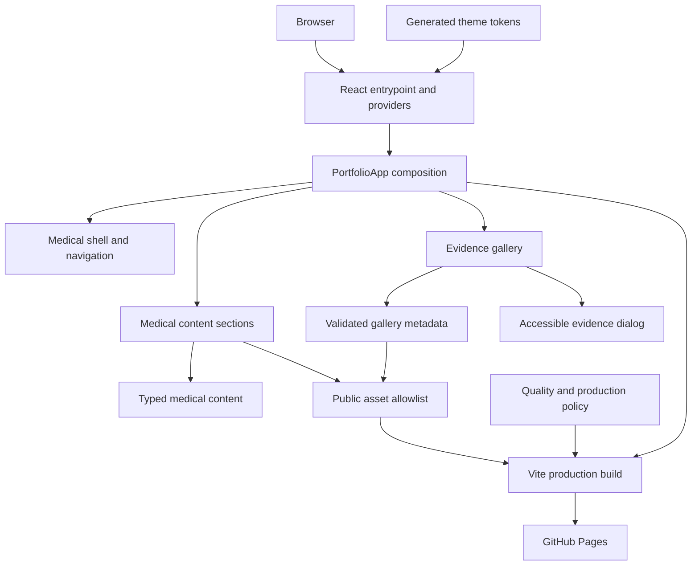
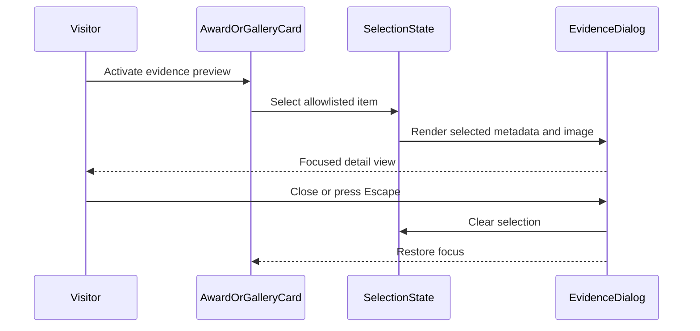

# System Architecture

## System Overview

The repository contains one static React 19 and TypeScript application built with Vite. `PortfolioApp` composes a single medical portfolio from typed local data, a privacy-safe asset allowlist, responsive section components, an accessible Chakra UI dialog, hash navigation, generated light/dark theme tokens, and local production-policy checks. GitHub Actions builds and deploys the verified `dist/` output to GitHub Pages.

## Architecture Diagram

Text alternative: the browser loads React providers and `PortfolioApp`. The app composes the medical shell, content sections, and evidence gallery from typed content, theme tokens, and approved assets. Tests and production policy validate the Vite build before GitHub Pages deployment.

## Component Descriptions

### Application Composition

- **Location**: `src/App.tsx`
- **Responsibilities**: Compose all eight sections and connect navigation state to the medical shell.
- **Dependencies**: Medical content, gallery metadata, navigation data, layout hook, and active-section utility.
- **Type**: Application.

### Medical Shell and Navigation

- **Location**: `src/components/medical/MedicalShell.tsx`, `MedicalNav.tsx`, and `src/hooks/useMedicalLayout.ts`
- **Responsibilities**: Responsive landmarks, sticky navigation, hash-safe links, active-section state, skip link, and color-mode control.
- **Type**: Presentation and browser behavior.

### Medical Content Sections

- **Location**: `src/components/medical/content/`
- **Responsibilities**: Render the hero, narrative, education/GPA, academic scores, science/awards, leadership/service, and Contact content through shared section primitives.
- **Dependencies**: Typed content and approved assets.
- **Type**: Presentation.

### Evidence Gallery

- **Location**: `src/components/medical/gallery/` and `src/utils/medicalGallery.ts`
- **Responsibilities**: Validate gallery collections, manage selection/error state, render evidence cards, open one accessible detail dialog, and restore focus.
- **Dependencies**: Chakra Dialog, gallery metadata, and asset allowlist.
- **Type**: Presentation and pure state logic.

### Content and Asset Policy

- **Location**: `src/data/medical/` and `src/types/medicalPortfolio.ts`
- **Responsibilities**: Define verified content, the 13-image gallery, the approved CV, exact public asset allowlist, navigation, and privacy tests.
- **Type**: Application model and policy boundary.

### Theme System

- **Location**: `src/theme/`
- **Responsibilities**: Resolve preferences, generate theme CSS, validate contrast, apply reduced motion, and bootstrap color mode safely.
- **Type**: Shared UI support.

### Build and Delivery

- **Location**: `vite.config.ts`, `scripts/verify-production-build.mjs`, `.github/workflows/deploy.yml`
- **Responsibilities**: Build root or repository-base-path output, reject prohibited production content, and deploy verified static artifacts.
- **Type**: Build and infrastructure automation.

## Evidence Review Interaction

Text alternative: activating an allowlisted evidence control selects its item and opens a focused dialog. Closing the dialog clears selection and restores focus to the originating control.

## Integration Points

- **External APIs**: None.
- **Databases**: None.
- **Runtime network requests**: None for portfolio content.
- **Third-party libraries**: Chakra UI for accessible dialog primitives; next-themes for color mode; React Icons for interface icons.
- **Static hosting**: GitHub Pages through GitHub Actions.
- **Reference design**: `trangiaminhtam.github.io` is an external visual reference only and is not a runtime dependency.

## Infrastructure Components

- **CDK/Terraform/CloudFormation**: None.
- **Deployment**: GitHub Actions installs locked dependencies, runs quality gates, derives `VITE_BASE_PATH`, builds, verifies, and deploys `dist/`.
- **Networking**: Public static hosting only.
- **Secrets**: None required by the application.
