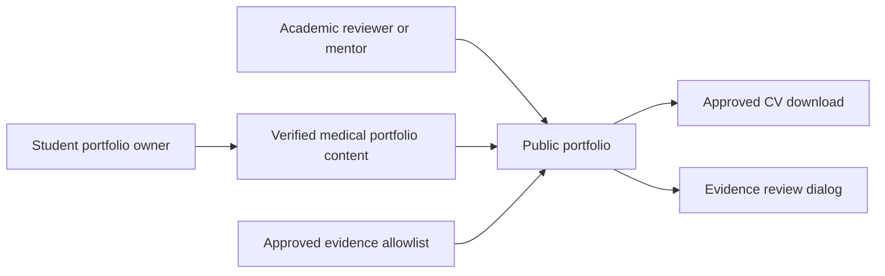

# Business Overview

## Business Context

Text alternative: the student supplies verified content and explicitly approved evidence. Academic reviewers and mentors use the public site to understand the medical pathway, review evidence, and download the approved CV.

## Business Description

- **Purpose**: Present Bui Tuan Phat's verified medical-study pathway through a polished, privacy-safe, accessible static portfolio.
- **Primary audiences**: Academic reviewers, scholarship and program reviewers, mentors, peers, and collaborators.
- **Delivery model**: Public GitHub Pages site with no backend, authentication, database, analytics, or runtime content service.

## Business Transactions

1. **Understand the student profile**: A visitor reads the Overview and Calling to Medicine sections.
2. **Review academic development**: A visitor reviews education milestones, GPA progression, scores, and scholarship recognition.
3. **Review science and award evidence**: A visitor reads science projects and awards and sees approved supporting images.
4. **Inspect evidence in detail**: A visitor activates an evidence card, reviews the larger image in an accessible dialog, closes it, and returns focus to the originating control.
5. **Review leadership and service**: A visitor reads verified activities without clinical overstatement.
6. **Download the approved CV**: A visitor downloads the explicitly approved public PDF.
7. **Navigate the portfolio**: A visitor uses sticky responsive anchors and active-section feedback.
8. **Switch color mode**: A visitor chooses an accessible light or dark medical theme.

## Business Dictionary

- **Approved evidence**: A local media asset explicitly listed in the public asset allowlist.
- **Evidence gallery**: Thirteen reviewed public images with keyboard-accessible detail viewing.
- **Award evidence**: An allowlisted image associated with an award entry.
- **Private source**: A source record used for verification but prohibited from public output.
- **Medical section**: One of the eight anchored areas in the single-page narrative.
- **Placeholder contact**: Clearly fictional, non-actionable contact copy that must not be treated as a real channel.

## Component-Level Business Descriptions

### Medical Content System

- Owns verified hero, education, GPA, scores, awards, activities, and Contact content.
- Keeps data separate from presentation and preserves evidence traceability.

### Public Asset Boundary

- Exposes only explicitly allowlisted images and the approved CV PDF.
- Prevents private CV-source documents and prohibited markers from entering the production graph.

### Portfolio Presentation

- Renders the eight-section medical narrative, responsive navigation, light/dark themes, evidence cards, and dialogs.
- Preserves semantic reading order, keyboard access, and reduced-motion behavior.

### Build and Delivery

- Runs TypeScript, ESLint, example/property tests, production policy checks, and Vite builds.
- Publishes static output through the existing GitHub Pages workflow.
