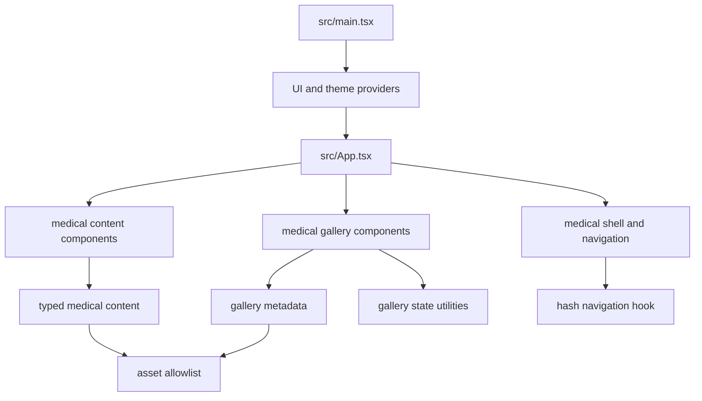

# Code Structure

## Build System

- **Package manager**: npm with committed `package-lock.json`.
- **Application build**: TypeScript project build followed by Vite.
- **Quality scripts**: `typecheck`, `lint`, `test`, `quality`, `build`, and `verify:dist` in `package.json`.
- **Deployment configuration**: `.github/workflows/deploy.yml`.

## Current Module Hierarchy

Text alternative: `main.tsx` mounts providers and `App`. `App` composes the medical shell, content sections, and gallery. Components consume typed content, gallery metadata, pure gallery state utilities, hash navigation, and the shared asset allowlist.

## Existing Files Relevant to the Requested Change

- `src/components/medical/content/MedicalSection.tsx` - Shared non-hero header/body section structure.
- `src/components/medical/content/medical-content.css` - Section headings, GPA cards, awards, research, activities, and shared visual treatment.
- `src/components/medical/content/EducationJourney.tsx` - Grade 10-12 GPA markup.
- `src/components/medical/content/ScienceAndAwards.tsx` - Science feature and award-group composition.
- `src/components/medical/content/ContentPrimitives.tsx` - Award, score, timeline, research, and activity primitives.
- `src/components/medical/gallery/EvidenceGallery.tsx` - Gallery selection orchestration and focus restoration.
- `src/components/medical/gallery/GalleryItem.tsx` - Clickable evidence card.
- `src/components/medical/gallery/GalleryModal.tsx` - Accessible detail dialog.
- `src/components/medical/gallery/medical-gallery.css` - Gallery cards, modal sizing, and viewport inset.
- `src/data/medical/content.ts` - GPA values and award-to-evidence associations.
- `src/data/medical/gallery.ts` - Detailed evidence metadata for 13 reviewed images.
- `src/data/medical/assetAllowlist.ts` - Approved public image and CV boundary.
- `src/types/medicalPortfolio.ts` - Award, GPA, gallery, and portfolio contracts.
- `src/App.tsx` - Final section composition.
- `src/components/medical/content/MedicalContent.test.tsx` - Content/component regression coverage.
- `src/components/medical/content/medicalContentStyles.test.ts` - CSS contract assertions.
- `src/components/medical/gallery/EvidenceGallery.test.tsx` - Dialog behavior and focus coverage.
- `src/components/medical/gallery/medicalGalleryStyles.test.ts` - Gallery source/style safeguards.

## Design Patterns

### Typed Content Configuration

- Content is defined in `src/data/medical/content.ts` and rendered through typed props.
- Presentation components do not parse source documents or fetch content at runtime.

### Explicit Public Asset Allowlist

- Only assets listed in `ALLOWED_ASSETS` can be rendered by medical components.
- Tests reject private, prohibited, dynamically discovered, or unapproved files.

### Shared Section Primitive

- `MedicalSection` preserves one semantic `h2`, introduction, source order, tone, and stable section ID across non-hero sections.

### Pure Gallery State Machine

- `transitionGalleryState`, collection validation, and item resolution are pure utilities with example and property tests.
- Chakra Dialog owns focus containment, Escape handling, and focus restoration hooks.

### Generated Theme Tokens

- Named tokens support consistent light/dark medical palettes and contrast validation.

## Critical Dependencies

- React and React DOM 19.2.3.
- Chakra UI 3.30.0 and Emotion 11.14.0.
- Vite 7.3.0 and TypeScript 5.9.3.
- Vitest 4.1.9, Testing Library 16.3.2, jsdom 29.1.1, and fast-check 4.10.1.

## Current Maintainability Risks

- Several retired general-purpose `src/data/*.ts` and shared components remain even though the current runtime graph is medical-only.
- The worktree contains extensive pre-existing user changes and untracked medical files; new work must avoid broad cleanup or resets.
- Award evidence and gallery evidence currently duplicate some metadata rather than sharing one canonical evidence-view model.
- Award thumbnails are static images, while only gallery cards currently open the detail dialog.
- The GPA scale is inline text and can break between `/1` and `0` under constrained card width.
