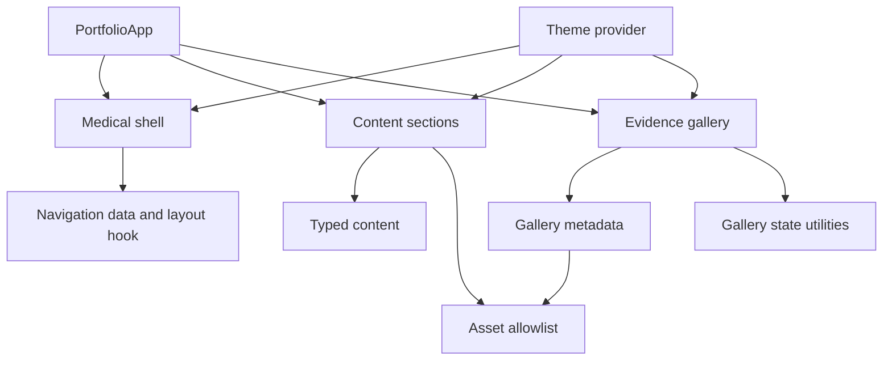

# Dependencies

## Internal Dependencies

Text alternative: `PortfolioApp` depends on the medical shell, content sections, and gallery. Content and gallery depend on typed local data and the asset allowlist. The shell depends on navigation data and the layout hook. Theme providers support all presentation layers.

## Key Internal Relationships

- `App.tsx` passes typed content and gallery collections into presentation components.
- `AwardItem` validates optional evidence against the same allowlist used by gallery metadata.
- `EvidenceGallery` uses pure gallery utilities and Chakra Dialog components.
- `MedicalSection` supplies consistent section heading/body semantics to all non-hero areas.
- Production tests and `verify-production-build.mjs` validate the assembled runtime graph and output.

## External Runtime Dependencies

| Dependency | Version | Purpose |
|---|---:|---|
| React / React DOM | 19.2.3 | Component rendering |
| Chakra UI | 3.30.0 | Accessible dialog and UI primitives |
| Emotion React | 11.14.0 | Chakra styling runtime |
| next-themes | 0.4.6 | Color-mode preference |
| React Icons | 5.5.0 | Interface icons |
| React Markdown | 10.1.0 | Legacy local journal rendering |

## Development Dependencies

| Dependency | Version | Purpose |
|---|---:|---|
| Vite | 7.3.0 | Development and production build |
| TypeScript | 5.9.3 | Static typing and compilation |
| Vitest | 4.1.9 | Test runner |
| Testing Library React | 16.3.2 | DOM/component tests |
| jsdom | 29.1.1 | Browser-like test environment |
| fast-check | 4.10.1 | Property-based testing |
| ESLint | 9.39.2 | Static analysis |
| Prettier | 3.7.4 | Formatting |

## Dependency Constraints

- No new dependency is required for the requested visual work because the current dialog, state, CSS, test, and image infrastructure are sufficient.
- The main JavaScript chunk has an existing non-blocking size advisory; avoid adding another UI or modal library.
- The external reference site is design research only and must not become a code, asset, font, or runtime dependency.
